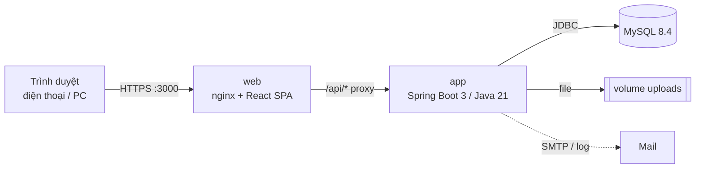
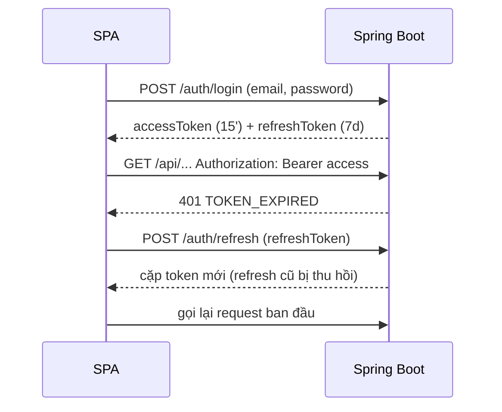
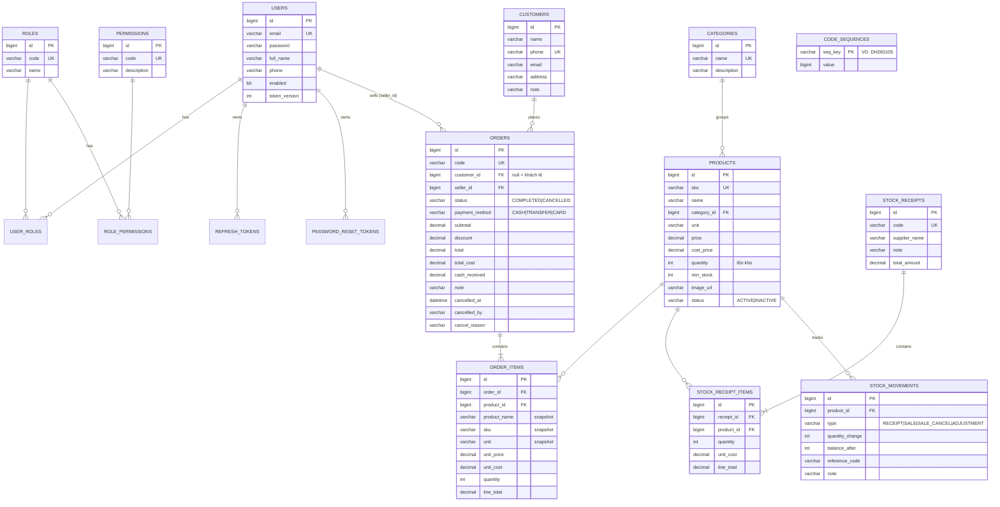

# ARCHITECTURE – TiệmPro

> Solution Architect · MVP 1.0

## 1. Tổng quan kiến trúc



- **Kiểu kiến trúc:** monolith mô-đun (modular monolith), REST JSON, stateless (JWT). Phù hợp quy mô cửa hàng nhỏ, triển khai 1 máy chủ/VPS.
- **Backend:** package theo feature (`auth`, `user`, `category`, `product`, `customer`, `order`, `inventory`, `dashboard`, `file`, `mail`) + `common`, `config`, `security`. Mỗi feature: `entity → repository → dto → mapper (MapStruct) → service → controller`.
- **Frontend:** SPA React + Vite + TypeScript; React Query (server state), React Router (định tuyến + guard quyền), React Hook Form + Zod (form), Tailwind (UI), axios (HTTP + interceptor refresh token).
- **Dữ liệu:** MySQL 8.4, schema do **Flyway** quản lý (`ddl-auto=validate`); dữ liệu demo ở location riêng `db/demo`.
- **Triển khai:** `docker compose up` → 3 service `mysql`, `app`, `web`. CI GitHub Actions: build + unit + integration (Testcontainers) + e2e (Playwright trên compose).

### Luồng xác thực


### Luồng tạo đơn (bảo đảm không âm kho)
```mermaid
sequenceDiagram
    participant FE as POS
    participant S as OrderService
    participant DB as MySQL
    FE->>S: POST /orders {items, customerId, discount, payment}
    S->>DB: BEGIN; SELECT products WHERE id IN (...) ORDER BY id FOR UPDATE
    S->>S: kiểm tra trạng thái, tồn kho, giảm giá ≤ tạm tính
    S->>DB: UPDATE products.quantity; INSERT orders, order_items, stock_movements
    S->>DB: COMMIT
    S-->>FE: 201 {code: DH260105-0001, total, ...}
```

## 2. ERD



Mọi bảng nghiệp vụ có thêm các cột của `BaseEntity`: `version, created_at, updated_at, created_by, updated_by` (không vẽ để gọn). `created_by` của đơn/phiếu/biến động kho chính là "người thực hiện".

**Index chính:** `orders(created_at)`, `orders(status, created_at)`, `orders(seller_id)`, `orders(customer_id)`, `order_items(product_id)`, `stock_movements(product_id, created_at)`, `products(category_id)`, `products(status)`, `customers(name)`.

## 3. Danh sách API (prefix `/api/v1`)

Mọi response bọc trong `ApiResponse { success, code, message, data, errors, timestamp }`; danh sách trả `PageResponse` (`page` từ 0, `size` ≤ 100, `sort=field,dir`).

| Nhóm | Method & path | Quyền | Mô tả |
|---|---|---|---|
| Public | `GET /public/app-info` | – | Tên ứng dụng, cờ demo (để hiện tài khoản demo) |
| Auth | `POST /auth/login` | – | Đăng nhập |
| | `POST /auth/refresh` | – | Xoay vòng refresh token |
| | `POST /auth/logout` | đăng nhập | Blacklist access + thu hồi refresh |
| | `POST /auth/forgot-password` · `POST /auth/reset-password` | – | Quên / đặt lại mật khẩu |
| | `POST /auth/change-password` | đăng nhập | Đổi mật khẩu |
| | `POST /auth/register` | – (chỉ khi bật cờ) | Đăng ký công khai |
| Người dùng | `GET /users/me` | đăng nhập | Hồ sơ + roles + permissions |
| | `GET /users` | `USER_READ` | Tìm kiếm, phân trang |
| | `POST /users` | `USER_MANAGE` | Tạo tài khoản |
| | `PUT /users/{id}` | `USER_MANAGE` | Sửa họ tên, SĐT, vai trò |
| | `PATCH /users/{id}/status` | `USER_MANAGE` | Khoá / mở khoá |
| | `GET /roles` | `USER_READ` | Danh sách vai trò |
| Nhóm hàng | `GET /categories` | `CATEGORY_READ` | Tất cả nhóm + số sản phẩm |
| | `POST /categories` · `PUT /categories/{id}` · `DELETE /categories/{id}` | `CATEGORY_MANAGE` | |
| Sản phẩm | `GET /products?keyword&categoryId&status&lowStock` | `PRODUCT_READ` | `costPrice` chỉ trả khi có `PRODUCT_COST_VIEW` |
| | `GET /products/{id}` | `PRODUCT_READ` | |
| | `POST /products` | `PRODUCT_CREATE` | |
| | `PUT /products/{id}` | `PRODUCT_UPDATE` | Không đổi tồn kho |
| | `DELETE /products/{id}` | `PRODUCT_DELETE` | 409 nếu đã phát sinh giao dịch |
| Khách hàng | `GET /customers?keyword` | `CUSTOMER_READ` | Kèm số đơn, tổng chi tiêu |
| | `GET /customers/{id}` | `CUSTOMER_READ` | Chi tiết + thống kê + đơn gần đây |
| | `POST /customers` · `PUT /customers/{id}` | `CUSTOMER_WRITE` | |
| | `DELETE /customers/{id}` | `CUSTOMER_DELETE` | 409 nếu đã có đơn |
| Đơn hàng | `GET /orders?from&to&status&keyword&customerId` | `ORDER_READ` | Thiếu `ORDER_READ_ALL` → chỉ đơn của mình |
| | `GET /orders/{id}` | `ORDER_READ` | Như trên |
| | `POST /orders` | `ORDER_CREATE` | Tạo đơn, trừ tồn |
| | `POST /orders/{id}/cancel` | `ORDER_CANCEL` | Huỷ, hoàn tồn |
| Kho | `GET /stock-receipts` · `GET /stock-receipts/{id}` | `STOCK_READ` | |
| | `POST /stock-receipts` | `STOCK_MANAGE` | Nhập hàng, cộng tồn, giá vốn bình quân |
| | `GET /stock-movements?productId&type` | `STOCK_READ` | Lịch sử xuất nhập tồn |
| | `POST /stock-adjustments` | `STOCK_MANAGE` | Kiểm kho |
| Báo cáo | `GET /dashboard` | `DASHBOARD_VIEW` | KPI, doanh thu 14 ngày, top SP, sắp hết, đơn gần đây |
| File | `POST /files` · `GET /files?key` · `DELETE /files?key` | đăng nhập / `FILE_DELETE` | Ảnh sản phẩm |

Tài liệu tương tác: Swagger UI `/swagger-ui.html` (tắt ở prod trừ khi `SWAGGER_ENABLED=true`).

## 4. Phân quyền

Authority = `ROLE_<role>` + các mã permission. Kiểm tra tại controller bằng `@PreAuthorize("hasAuthority('...')")`, kiểm tra "dữ liệu của mình" (đơn hàng của STAFF) trong service.

| Permission | ADMIN | MANAGER | STAFF | USER |
|---|:-:|:-:|:-:|:-:|
| DASHBOARD_VIEW | ✔ | ✔ | | |
| PRODUCT_READ | ✔ | ✔ | ✔ | ✔ |
| PRODUCT_CREATE / UPDATE / DELETE | ✔ | ✔ | | |
| PRODUCT_COST_VIEW | ✔ | ✔ | | |
| CATEGORY_READ | ✔ | ✔ | ✔ | |
| CATEGORY_MANAGE | ✔ | ✔ | | |
| CUSTOMER_READ / CUSTOMER_WRITE | ✔ | ✔ | ✔ | |
| CUSTOMER_DELETE | ✔ | ✔ | | |
| ORDER_READ / ORDER_CREATE | ✔ | ✔ | ✔ | |
| ORDER_READ_ALL / ORDER_CANCEL | ✔ | ✔ | | |
| STOCK_READ / STOCK_MANAGE | ✔ | ✔ | | |
| USER_READ / USER_MANAGE | ✔ | | | |
| FILE_DELETE | ✔ | | | |

Frontend nhận danh sách `permissions` từ `/users/me` để ẩn menu/nút và chặn route (`<RequirePermission>`).

## 5. Cấu trúc thư mục

```
.
├── src/main/java/com/example/starter
│   ├── common/ config/ security/        # nền tảng (từ template)
│   ├── auth/ user/ file/ mail/          # từ template (mở rộng user management)
│   ├── category/  product/  customer/   # danh mục
│   ├── order/                           # bán hàng
│   ├── inventory/                       # phiếu nhập, kiểm kho, lịch sử kho, CodeGenerator
│   └── dashboard/                       # báo cáo tổng quan
├── src/main/resources
│   ├── db/migration/                    # schema + seed role/permission
│   └── db/demo/                         # dữ liệu demo tiếng Việt (bật bằng APP_DEMO_DATA)
├── src/test/java/...                    # *Test (unit), *IT (integration, Testcontainers)
├── frontend/
│   ├── src/api/                         # axios client, API theo feature, types
│   ├── src/auth/                        # AuthContext, guard, quyền
│   ├── src/components/                  # ui/ (Button, Input, Modal...) + layout/
│   ├── src/features/<feature>/          # page + component theo màn hình
│   ├── src/lib/                         # format tiền/ngày, helper
│   ├── Dockerfile, nginx.conf
│   └── vitest (src/**/*.test.ts[x])
├── e2e/                                 # Playwright test luồng chính
├── docs/                                # PRD, DESIGN, ARCHITECTURE, CHECKLIST, TEST_PLAN, DECISIONS, FINAL_REPORT
├── Dockerfile                           # backend
├── docker-compose.yml                   # mysql + app + web
└── .github/workflows/ci.yml             # backend, frontend, e2e
```

## 6. Quyết định kỹ thuật chính
Xem [DECISIONS.md](DECISIONS.md): khoá bi quan khi trừ kho (D07), mã chứng từ (D08), không xoá cứng chứng từ (D09), lưu token (D11), nginx proxy (D12), dữ liệu demo (D13).

## 7. Bảo mật
- JWT HS256/384, access 15 phút, refresh xoay vòng + phát hiện dùng lại, blacklist khi logout, `token_version` khi đổi mật khẩu/khoá tài khoản.
- BCrypt; không tiết lộ email tồn tại (login/forgot).
- Truy vấn qua JPA/Criteria (tham số hoá) → chống SQL injection; `LIKE` có escape ký tự đặc biệt; sort chỉ nhận thuộc tính entity hợp lệ.
- Validate input bằng Bean Validation ở mọi request body.
- Secret qua biến môi trường; prod không có giá trị mặc định cho secret.
- nginx: header bảo mật (CSP, X-Frame-Options, X-Content-Type-Options, Referrer-Policy).
- Upload: giới hạn dung lượng, whitelist content-type, chống path traversal.
